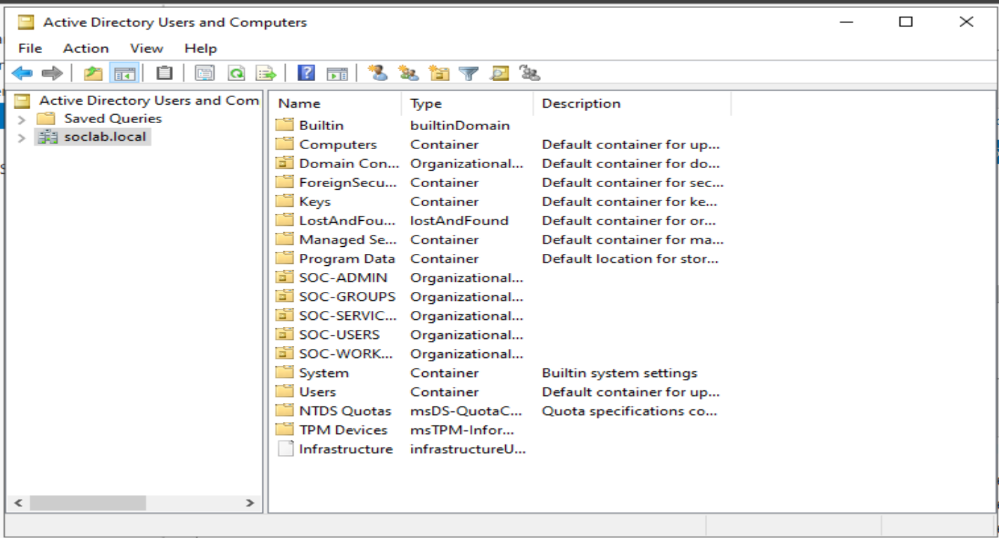

# IAM Active Directory RBAC Security Lab

A hands-on Identity and Access Management (IAM) security lab built with Windows Server 2022, Active Directory Domain Services (AD DS), and a Windows 11 domain client.

The lab demonstrates centralized identity management, role-based group administration, domain authentication, account-lockout policy configuration, and Windows Security event review in the `soclab.local` domain.

## Lab environment

| Component | Configuration |
|---|---|
| Domain controller | Windows Server 2022 |
| Client | Windows 11 |
| Directory service | Active Directory Domain Services |
| Domain | `soclab.local` |
| Access-control model | Active Directory security groups |
| Policy management | Group Policy |
| Monitoring | Windows Security Event Logs |

## Architecture

The Windows Server 2022 domain controller provides directory, DNS, authentication, and policy services for `soclab.local`. The Windows 11 client is domain joined and is used to test identity and access controls.



## Documentation

| Area | Description |
|---|---|
| [Active Directory setup](setup/active-directory.md) | Domain foundation, DNS role, verified directory organization, and evidence. |
| [Windows client setup](setup/windows-client.md) | Domain-client role and the validation scope recorded for the lab. |
| [User accounts](identity-management/user-accounts.md) | Identity-management approach and redacted documentation labels. |
| [RBAC implementation](access-control/rbac-implementation.md) | Security groups, membership evidence, and resource-access evidence. |
| [Account lockout and monitoring](security/account-lockout.md) | Recorded policy values and observed authentication/lockout evidence. |
| [Test cases](testing/test-cases.md) | Evidence-linked validation status and remaining gaps. |

## RBAC evidence chain

The core lab design is that access is granted through a role group, not by assigning a user directly to a resource:

```text
Domain user → Active Directory identity → role group → resource permission → access decision
```

| Published identity label | Role group | Protected resource / validation | Result recorded |
|---|---|---|---|
| `SOC-ADMIN-01` | `ADMINS` | `\\Soc-dc\admin_files` | Share contents were successfully opened; the capture does not identify the signed-in user or show the share ACL. |
| `SOC-ANALYST-01` | `ANALYST` | Role-group membership | Membership view recorded. No resource authorization test is recorded. |
| `SOC-SUPPORT-01` | `IT-SUPPORT` | Role-group assignment | Assignment is documented; no membership or resource test is recorded. |
| `SOC-USER-01` | `GG-SOC-USERS` | `\\Soc-dc\admin_files` | Access-denied result recorded; the capture does not identify the attempted user. |

The labels are redacted documentation identifiers, not the actual AD usernames. The [RBAC implementation](access-control/rbac-implementation.md) distinguishes recorded evidence from the remaining ACL and identity-verification gap.

## Evidence highlights

- The AD Users and Computers view shows the `soclab.local` domain and lab OUs, including `SOC-GROUPS` and `SOC-USERS`.
- Group membership evidence records users assigned to role groups. The repository also records successful opening of, and denied access to, the `admin_files` share.
- The default domain password-policy output records a lockout threshold of five attempts, with a 30-minute lockout duration and observation window.
- Security logs include failed-logon Event ID 4625 and account-lockout Event ID 4740 evidence.

See the [test cases](testing/test-cases.md) for the precise status of each claim. In particular, Event ID 4767 (account unlock) is not recorded in the repository and is not claimed as validated.

## Repository structure

```text
IAM-Active-Directory-RABC-security-lab/
├── README.md
├── setup/
├── identity-management/
├── access-control/
├── security/
├── testing/
└── screenshots/
    ├── AD-Architecture/
    ├── Identity-and-RBAC/
    ├── Resource-Permissions/
    ├── Access-Testing/
    └── Security-Monitoring/
```

## Security notes

- Use individual accounts and assign resource permissions through groups where practical.
- Apply least privilege and periodically review group membership.
- Do not commit passwords, credentials, or sensitive configuration data.
- Perform testing only in an authorized lab environment.

## Project status

The repository documents the Active Directory foundation, role-group organization, resource-access testing, and observed authentication/lockout events. The remaining documented gap is verification of an account-unlock audit event (4767).

---

**Author:** Prasanna Waichale
**Repository:** [IAM Active Directory RBAC Security Lab](https://github.com/waichaleprasanna/IAM-Active-Directory-RABC-security-lab)
