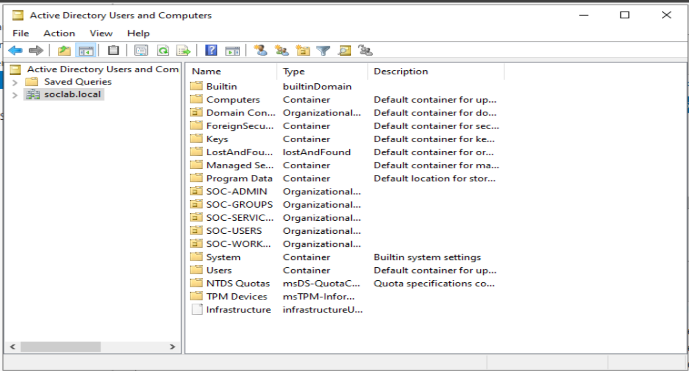

# Active Directory Domain Setup

## Overview

Windows Server 2022 was configured as the Active Directory Domain Services (AD DS) domain controller for the `soclab.local` lab domain. The domain controller centralizes directory objects, authentication, security-group membership, and policy management for the Windows 11 client.

| Setting | Value |
|---|---|
| Domain | `soclab.local` |
| Domain controller OS | Windows Server 2022 |
| Directory service | Active Directory Domain Services |
| Client OS | Windows 11 |

## Domain-controller role

The domain controller maintains Active Directory user, computer, and group objects; authenticates domain users; evaluates group memberships for access decisions; and records relevant security events. DNS is integral to this design: a domain client uses DNS to locate the domain controller and domain services.

## Directory organization

The evidence shows the `soclab.local` domain with a `SOC-GROUPS` OU and a `SOC-USERS` OU. The latter is also confirmed by the recorded group-membership view. The domain overview screenshot shows additional lab OUs, but their labels are truncated in the captured view; they are deliberately not transcribed here.

```text
soclab.local
├── SOC-GROUPS
└── SOC-USERS
```

## Validation scope

The repository evidence supports that the `soclab.local` domain is present, role groups and user objects are organized in Active Directory, and authentication-related activity was reviewed. The separately documented Windows client and test-case records describe the client-integration and authentication checks.

## Evidence



- [SOC-GROUPS view](../screenshots/AD-Architecture/active-directory-soc-groups.png)
- [SOC-USERS view](../screenshots/AD-Architecture/active-directory-soc-users.png)
- [Directory architecture diagram](../screenshots/AD-Architecture/mermaid-diagram.png)
